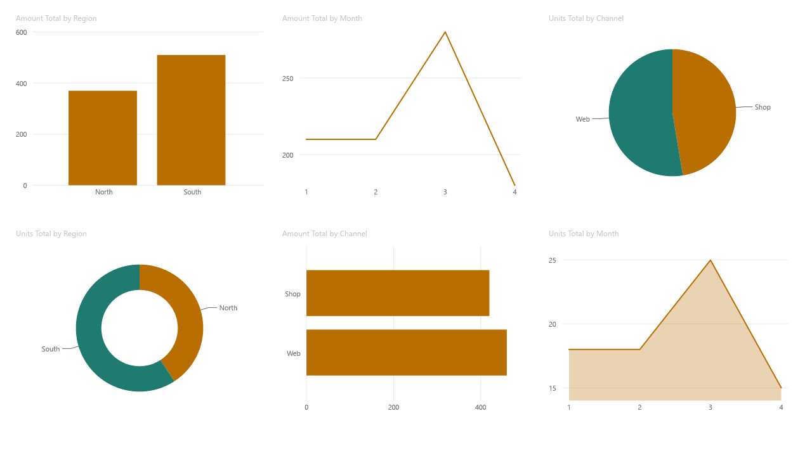

<p align="center">
  <picture>
    <source media="(prefers-color-scheme: dark)" srcset="assets/logo/bicraft-logo-dark.svg">
    
  </picture>
</p>

<h1 align="center">BIcraft</h1>

<p align="center">
  <b>Power BI files, from the command line and from AI agents; an open-source file toolkit built in pure Rust.</b>
</p>

<p align="center">
  Create, read, modify, validate and convert PBIX, PBIT and PBIP files, their TMDL and TMSL models
  and their PBIR reports, and check every DAX expression against the model. One binary,
  <code>bicraft</code>, is both a CLI and an MCP server, so people, scripts and agents use the same
  commands. Native on Windows and Linux; files it writes open in the free Power BI Desktop.
</p>

<p align="center">
  
  
  
  
  
</p>

<p align="center">
  
  <br><sub><b>A synthetic report page</b> built with <code>bicraft run</code> (the corpus recipe <code>corpus/recipes/visuals.json</code>, then <code>theme.set {"builtin": "bicraft"}</code>) and drawn by <code>bicraft render</code>; every value is made up.</sub>
</p>

<p align="center">
  <a href="#what-sets-bicraft-apart">What sets it apart</a> ·
  <a href="#what-works-today">What works</a> ·
  <a href="#getting-started">Getting started</a> ·
  <a href="#agents-cli-and-mcp">Agents, CLI and MCP</a> ·
  <a href="#server-and-kubernetes">Server</a> ·
  <a href="#how-it-is-built">How it is built</a> ·
  <a href="#roadmap">Roadmap</a> ·
  <a href="#downloads">Downloads</a> ·
  <a href="#interoperability">Interoperability</a> ·
  <a href="#the-crafting-apps">The Crafting Apps</a> ·
  <a href="#license-and-credits">License</a>
</p>

## What sets BIcraft apart

- **Its own report app, on the desktop and in the browser.** `bicraft-desktop` and the browser
  app run the same Rust UI (egui), draw the same pixels and reach every engine command from a
  button: model, Data and Report views, the Format pane, Power Query, DAX with a formula bar.
  Native on Windows and Linux, no web engine inside ([docs/desktop.md](docs/desktop.md),
  [docs/webui.md](docs/webui.md)).
- **A server for teams, with a Kubernetes deployment (preview).** `bicraft serve` hosts
  workspaces for many users over MCP Streamable HTTP, with API tokens or OIDC sign-in,
  per-workspace access control and a sandboxed root. A static container image, a Helm chart and a
  controller that creates workspaces on demand. Tested so far in a local kind cluster and against
  a test identity provider only ([docs/kubernetes.md](docs/kubernetes.md),
  [docs/server-mode.md](docs/server-mode.md)).
- **Fourteen visuals of its own, for the charts people keep asking Power BI for.** Org chart,
  Waterfall+ (horizontal, subtotals), histogram, bullet chart, box plot, Venn, Marimekko,
  dumbbell and slope, calendar heatmap, Sankey, Scatter+, Line / Area+, Gauge / KPI+, and the
  Spec visual (a chart described in a few lines of JSON). They ship as standard custom visual
  packages that open in Power BI Desktop, draw the same in BIcraft and in Power BI, follow the
  report's language, and still draw when the visual is very small
  ([docs/community-visuals.md](docs/community-visuals.md),
  [docs/formats/bicraft-visuals.md](docs/formats/bicraft-visuals.md)).
- **An engine built for large volumes.** A columnar storage engine over the VertiPaq segments
  answers the 22 queries of its star-schema bench at every size from 10 k to 100 M fact rows;
  measured on the maintainers' laptop, a 100 M-row model opens in 1.8 s and most repeated queries come
  back from its caches in under a millisecond, and models larger than memory are read by windows
  ([docs/benchmarks.md](docs/benchmarks.md), [docs/storage-engine.md](docs/storage-engine.md),
  [docs/beyond-ram.md](docs/beyond-ram.md)).
- **Made for AI agents and pipelines.** Every operation is a command that the CLI, the MCP
  server and the UI share, so an agent can do anything a person can; `bicraft test` gates a
  project in CI.

## What works today

BIcraft is pre-1.0 and under active development (see the [roadmap](ROADMAP.md)). Today it can:

- **Read every Power BI file format**: PBIX and PBIT packages (including the XPress9-compressed
  `DataModel`, its ABF backup, `metadata.sqlitedb` and VertiPaq column data), PBIP projects with
  TMDL or TMSL (`model.bim`) models, PBIR reports and legacy `Report/Layout` / `report.json`
  reports.
- **Author semantic models**: tables, columns, measures, relationships, hierarchies, calculation
  groups, roles, perspectives and translations, with byte-stable TMDL and TMSL writers. Renames
  rewrite the DAX that uses them; undo/redo and all-or-nothing batches.
- **Author reports**: pages and visuals with every formatting option checked against a catalog,
  themes, filters, conditional formatting, and declarative, idempotent report building
  (`report.apply`).
- **Validate DAX**: measures, calculated columns and tables, row filters and DAX queries
  (`DEFINE` / `EVALUATE`), with a typed catalog of 472 functions, type and context checks and
  circular-reference detection. Its verdicts are calibrated against the Analysis Services engine.
- **Write full PBIX files**: edits of an existing PBIX (metadata, structure and data), and new
  PBIX files built from a model, a PBIT or a PBIP project, with data encoded by a pure-Rust
  VertiPaq encoder and compressed with XPress9.
- **Convert**: PBIX → PBIP/PBIT, PBIT ↔ PBIP, TMSL ↔ TMDL, PBIP/PBIT/new model → PBIX. Every
  conversion goes through one in-memory model.
- **Query and preview**: run DAX queries over a file's data, render report pages to PNG, and watch
  a project in a live web viewer while an agent builds it. `bicraft-desktop` reads the same reports
  natively (Windows and Linux, no web engine), from a file or a BIcraft server.
- **Find what is used and what is not**: `bicraft usage` lists every place a table, column or
  measure is used (DAX, row-level security, relationships, visuals, filters, bookmarks), and
  `bicraft unused` lists, or removes, what nothing uses.
- **Gate a project in CI**: `bicraft test` runs DAX assertions over the data, best-practice and
  declarative model rules and report rules from a `bicraft.tests.yaml`, with JUnit or SARIF
  output for the pipeline ([docs/ci-tests.md](docs/ci-tests.md)).

### What is not finished or not tested

- **Not a full Analysis Services engine.** BIcraft's DAX evaluator serves previews, calculated
  data and refresh; DirectQuery is not executed, and a few DAX forms are left (G30).
- **Data sources.** Tables fed by database or web connectors cannot be computed when a new PBIX
  is built without a data cache. The SQL Server, Web, OData and SharePoint connectors are tested
  only against test servers; no OAuth or Windows sign-in to sources, no privacy firewall.
- **Server and Kubernetes are a preview.** OIDC is tested only against a local test provider,
  never a real identity provider; the Helm charts and the controller only in a local kind
  cluster, never on a managed cluster or under load; one controller replica.
- **Platforms.** Windows and Linux on x86-64. macOS is neither built nor tested.
- **Power BI.** Files and visuals are checked in Power BI Desktop; the Power BI service and
  Report Server are not tested. BIcraft's visuals are not certified, so they cannot be exported
  to PowerPoint or PDF from the service.
- **No release yet.** Nothing is published as a binary, and the release workflow has never run;
  the checks run on the maintainers' machines (Windows and WSL Ubuntu), not yet on public CI.

Every known shortfall is listed in [docs/gaps.md](docs/gaps.md); the plan is in
[ROADMAP.md](ROADMAP.md).

## Getting started

There are no published packages yet. Build from source with Rust 1.95 or newer:

```sh
git clone <this repository> bicraft
cd bicraft
cargo build --release -p bicraft-cli     # target/release/bicraft (bicraft.exe on Windows)
```

`cargo xtask dist` builds the Windows x64 and Linux x64 release archives locally, with an
install script, the licences, the notices and `SHA256SUMS` ([docs/releasing.md](docs/releasing.md)).

Every subcommand prints JSON to stdout and errors to stderr. Exit codes: `0` success or valid,
`1` invalid or a command failed, `2` usage or I/O error.

```sh
bicraft new-project out Sales --format tmdl            # a new PBIP project
bicraft inspect Sales.pbix                             # kind, parts, model, pages, visuals
bicraft validate-model out/Sales.pbip                  # every measure and calculated column
bicraft validate-dax "DIVIDE(SUM(Sales[Amount]), COUNTROWS(Sales))" --model out/Sales.pbip --table Sales
bicraft validate-report out/Sales.pbip                 # PBIR schemas, structure, bound fields
bicraft usage out/Sales.pbip "[Total Amount]"          # where a field is used (DAX, RLS, visuals, filters...)
bicraft unused out/Sales.pbip --remove --dry-run       # what nothing uses; then --remove --save
bicraft test out/Sales.pbip --format junit --output bicraft-junit.xml   # CI quality gates (docs/ci-tests.md)
bicraft convert Sales.pbix out/Sales.pbip --format pbip-tmdl
bicraft diff Sales.pbix out/Sales.pbip                # semantic diff across formats (docs/diff.md)
bicraft diff --git main HEAD out/Sales.pbip --markdown   # a project between git revisions, for a PR
bicraft dax-query Sales.pbix "EVALUATE SUMMARIZECOLUMNS(Sales[Region], \"Total\", [Total Amount])"
bicraft view out/Sales.pbip --open                     # live viewer in the browser
bicraft-desktop out/Sales.pbip                         # native desktop app, no browser (docs/desktop.md)
bicraft licenses                                       # licence and third-party notices
```

## Agents, CLI and MCP

Every operation in BIcraft is an engine command with a stable id, so people, scripts and AI
agents use the same verbs:

```sh
bicraft commands measure                               # list commands
bicraft describe measure.add                           # parameters of one command
bicraft run --open out/Sales.pbip \
  --cmd 'measure.add={"table":"Sales","name":"Total Amount","expression":"SUM(Sales[Amount])"}' \
  --save                                               # DAX is validated before it is applied
bicraft mcp                                            # MCP server over stdio
bicraft setup                                          # register `bicraft mcp` with your agents
```

Register the MCP server with any MCP client:

```json
{ "mcpServers": { "bicraft": { "command": "bicraft", "args": ["mcp"] } } }
```

`bicraft setup` writes this entry for Claude Code, Claude Desktop, VS Code, Cursor and Codex.
[docs/mcp.md](docs/mcp.md) lists the tools (`list_commands`, `run_command`, `batch`,
`open_file`, `inspect_file`, `validate_*`, `model_usage`, `model_unused`, `remove_unused`, `save`,
`save_as`, `convert`, …), the editing rules, undo/redo, the live viewer and a typical agent
workflow.

**Agent skills.** [skills/](skills/) holds guides for coding agents, in the `SKILL.md` format
(frontmatter `name` and `description`, with optional `references/`):
[bicraft-visual-authoring](skills/bicraft-visual-authoring/SKILL.md) takes an agent from "make
me a visual that…" to a packaged Power BI visual. It picks a built-in BIcraft visual, a Spec
visual or a scaffolded TypeScript visual, then checks, packs and exports it. Copy the folder into
your agent's skills directory (for Claude Code, `.claude/skills/` or `~/.claude/skills/`).

## Server and Kubernetes

`bicraft serve` exposes the same engine over MCP Streamable HTTP, one workspace per folder, with
authentication (API tokens or OIDC), per-workspace access control and a sandboxed workspace
root. A static container image and a Helm chart run one workspace per pod; a controller creates
workspaces on demand. See [docs/kubernetes.md](docs/kubernetes.md),
[docs/server-mode.md](docs/server-mode.md), [docs/auth.md](docs/auth.md) and
[docs/web-deployment.md](docs/web-deployment.md).

## How it is built

A Rust workspace (edition 2024) of layered crates: primitives (OPC, XPress9, SQLite, ABF,
VertiPaq) → model and report → DAX → serializations (TMSL, TMDL, PBIR, legacy layout) →
containers (PBIX, PBIP) → engine → MCP server and viewer → the `bicraft` CLI. A crate depends
only on lower layers (`cargo xtask layers`), and conversions always go through the model.

Input files are treated as hostile: no `unsafe`, no panicking calls, checked arithmetic, capped
allocations, bounded recursion, and fuzzed readers. BIcraft never calls Power BI Desktop, Analysis
Services or any Windows DLL at run time. [docs/architecture.md](docs/architecture.md) describes
the layers, [AGENTS.md](AGENTS.md) has the rules and [CONTRIBUTING.md](CONTRIBUTING.md) the
development setup.

## Roadmap

Every item of milestones M0–M12 is done: PBIP models, PBIR reports, PBIT and PBIX writing, the
`DataModel` reader and writer, DAX validation, distribution, the live viewer, languages, the one
egui UI and BIcraft's fourteen Power BI visuals. [ROADMAP.md](ROADMAP.md) says what is left,
[docs/gaps.md](docs/gaps.md) lists the open gaps and
[docs/history/roadmap-log.md](docs/history/roadmap-log.md) is the progress log;
[docs/benchmarks.md](docs/benchmarks.md) has BIcraft's performance numbers.

## Downloads

No release has been published yet, so there is nothing to download. Two ways to get the binaries:

- **Build from source** with Rust 1.95 or newer, as in [Getting started](#getting-started).
- **Build the release archives** with `cargo xtask dist` ([docs/releasing.md](docs/releasing.md)):

  | Platform | Archive | Holds |
  |---|---|---|
  | Windows x64 | `bicraft-<version>-windows-x64.zip` | `bicraft.exe`, `bicraft-desktop.exe`, `install.ps1` |
  | Linux x64 (static, musl) | `bicraft-<version>-linux-x64.tar.gz` | `bicraft`, `install.sh` |

  Each archive also holds the README, the MCP reference, BIcraft's fourteen Power BI visuals as
  `.pbiviz` files, the licences and the notices; `SHA256SUMS` lists a checksum per archive. The
  install scripts copy the binaries to a folder of your choice and never change `PATH`, the
  registry or client configurations.

The GitHub workflow `.github/workflows/release.yml` is ready to build `bicraft` archives for a
`v*` tag and attach them to a GitHub release; it has not been run yet.

## Interoperability

BIcraft is an interoperability implementation. It builds on Microsoft's public specifications
(`[MS-XLDM]` and the Open Specifications), Microsoft's published schemas (PBIR/PBIP JSON, report
themes) and the TMDL/TMSL documentation, open-source code and data under their licences (MIT, Apache-2.0,
BSD-3-Clause, CC0, the SIL Open Font License and others, listed in
[THIRD_PARTY_NOTICES.md](THIRD_PARTY_NOTICES.md)) and black-box testing with Power BI
Desktop on our own synthetic files. The format notes are in [docs/formats/](docs/formats/).

The XPress9 codec (`crates/xpress9`) is a Rust port of the C source Microsoft published under the
MIT licence in [microsoft/Extensible-Storage-Engine](https://github.com/microsoft/Extensible-Storage-Engine).
The PBIR and report theme schemas, the best-practice rules and the Selawik fonts are Microsoft
releases under MIT or the SIL Open Font License, vendored unmodified with their licences. The
repository holds no other Microsoft code and no Power BI files authored by others; test
fixtures are generated by the project.

[docs/interoperability.md](docs/interoperability.md) describes the sources, the black-box testing
and the rules contributors follow.

**Trademarks.** Power BI, Power BI Desktop, Analysis Services and Microsoft are trademarks of the
Microsoft group of companies. BIcraft is an independent open-source project. It is not affiliated
with, endorsed by or sponsored by Microsoft. The names are used only to describe the file formats
BIcraft works with.

## The Crafting Apps

BIcraft follows the development method of the **Crafting Apps**, the free, open-source Rust
tools of the [ArtCraft](https://getartcraft.com/) team, in particular
[DeckCraft](https://github.com/storytold/deckcraft): the same rules for agents, the same
"everything is a command" engine, one egui UI for the desktop and the browser, and the same
quality gate. [docs/method.md](docs/method.md) compares the two and lists where BIcraft keeps a
stricter rule of its own. BIcraft is a separate project: it is not made, endorsed or supported
by the ArtCraft team, and it does not use the ArtCraft name or marks.

| App | What it's for | Code |
|---|---|---|
| **PhotoCraft** | Image editing: layers, masks, type and real PSD files | [GitHub](https://github.com/storytold/photocraft) |
| **VectorCraft** | Vector illustration | [GitHub](https://github.com/storytold/vectorcraft) |
| **FilmCraft** | Video editing, color and sound | [GitHub](https://github.com/storytold/filmcraft) |
| **LightCraft** | Photo library and raw development | [GitHub](https://github.com/storytold/lightcraft) |
| **PdfCraft** | Reading, organizing and protecting PDFs | [GitHub](https://github.com/storytold/pdfcraft) |
| **EffectCraft** | Motion graphics and visual effects | [GitHub](https://github.com/storytold/effectcraft) |
| **DesignCraft** | Page layout and publishing | [GitHub](https://github.com/storytold/designcraft) |
| **FigCraft** | Interface design and prototyping | [GitHub](https://github.com/storytold/figcraft) |
| **WordCraft** | Word processing and documents | [GitHub](https://github.com/storytold/wordcraft) |
| **SoundCraft** | Audio recording and editing | [GitHub](https://github.com/storytold/soundcraft) |
| **DeckCraft** | Presentations and slide decks | [GitHub](https://github.com/storytold/deckcraft) |
| **CADCraft** | Computer-aided design | [GitHub](https://github.com/storytold/cadcraft) |
| **GridCraft** | Spreadsheets and data | [GitHub](https://github.com/storytold/gridcraft) |
| **TextureCraft** | 3D texture painting | [GitHub](https://github.com/storytold/texturecraft) |
| **Craft Anything** | Agent tooling for driving and checking applications | [GitHub](https://github.com/storytold/craft-anything) |
| **BIcraft** (this repository, independent) | Power BI files from the command line and from AI agents | [GitHub](https://github.com/digorpeptra/BIcraft) |

## License and credits

BIcraft is dual-licensed under [MIT](LICENSE-MIT) or [Apache-2.0](LICENSE-APACHE), at your option.
Copyright (c) 2026 the BIcraft contributors. Required notices are in [NOTICE](NOTICE).

Embedded third-party material keeps its own licence: each component is described in
[THIRD_PARTY_NOTICES.md](THIRD_PARTY_NOTICES.md), every asset is listed with its author, source
and licence in [ATTRIBUTION.md](ATTRIBUTION.md), and the licence texts are under
[`licenses/`](licenses/). `bicraft licenses` prints them.

Unless you explicitly state otherwise, any contribution intentionally submitted for inclusion in
the work by you, as defined in the Apache-2.0 license, shall be dual licensed as above, without
any additional terms or conditions.
